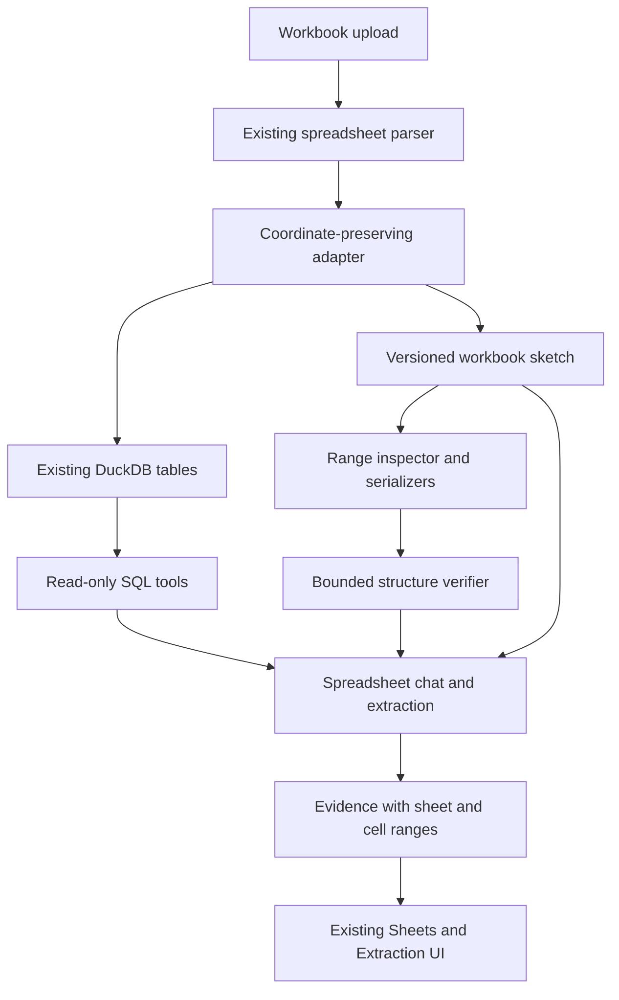

# SpreadsheetAgent Integration Architecture

## Goal and boundary

Add evidence-grounded spreadsheet understanding to DocuSight while retaining the current spreadsheet parser, DuckDB tables, chat, and UI as the foundation. The integration is scoped to spreadsheet paths. PDF ingestion, PDF localization, and PDF schema extraction remain unchanged.

The research paper's useful pattern is a two-stage loop: first build and verify a compact workbook structure, then solve a user question against that structure with localized tools. It does not justify copying the paper's large model deployment. DocuSight should use its existing configured LLM provider only for bounded structure suggestions and verification; deterministic workbook inspection remains local.

## Components and flow

### 1. Coordinate-preserving parsing

Keep `ingest_excel` and its current normalized DataFrames as the compatibility path. Add a spreadsheet-only adapter that retains each detected region's source sheet and inclusive start/end row/column, and maps normalized table rows and columns back to source cells. Capture raw value, cached formula value, formula expression when available, merged-range anchor, and basic style/number-format signals. CSV/TSV cells receive row/column coordinates too.

The adapter must not silently change DuckDB column naming or the current SQL schema. Preserve current upload behavior and make the new mapping additive. Treat `.xls` and `.ods` as supported where their parser can supply coordinates; expose reduced fidelity when formulas/styles are unavailable.

### 2. Typed workbook sketch

Persist a versioned JSON artifact at `data/docs/{doc_id}/spreadsheet_structure.json`. A Pydantic contract should include:

- source file hash, format, parser/schema version, and build timestamp;
- sheets, visibility, dimensions, source ranges and detected regions;
- table/region names, header rows (including hierarchy), normalized columns, and source-coordinate mappings;
- merged ranges, formulas/cached values availability, number formats, and basic style cues;
- row/column summaries, candidate key columns, candidate relationships, confidence, and review status;
- verification events and bounded correction history, without model chain-of-thought.

Store identifiers and references as explicit types rather than free-form prompt text. Validate every generated or updated sketch against the contract before persistence. Use source hash and parser version for cache invalidation.

### 3. Deterministic workbook inspector

Expose a small allowlist of operations: list sheets/regions, inspect a bounded cell range, read a cell including formula and cached value, summarize a range, perform typed lookup/aggregate, and validate a proposed field/value. Every response includes the source sheet and exact address or address set. Enforce limits on cell count, output bytes, and execution time. Do not allow model-authored Python, filesystem paths, formulas, or arbitrary SQL through these tools.

For table-wide numeric work, continue using `run_sql`'s read-only DuckDB restrictions. Add table-row-to-source-row mappings so results can cite contributing source rows when possible; clearly label aggregate provenance as a set/range rather than pretending a single cell produced it.

### 4. Local range representations

For a requested region, provide:

- a compact cell representation retaining coordinates, formulas, merged spans, and style signals;
- a LaTeX-like table serialization for header hierarchy and merged cells;
- an optional PNG of only the selected range using openpyxl style metadata and Pillow.

Rendering is bounded and local. LibreOffice may be detected as an optional fidelity enhancement; it is not a required runtime dependency. If rendering is unavailable, return a clear capability status and continue with cell/LaTeX representations.

### 5. Bounded extraction and verification

The existing provider abstraction (`llm.client`) supplies the configured model and API key. Ask the model only to propose structure interpretations or verify selected uncertain ranges. Validate structured output, resolve references through the inspector, and keep a configurable maximum number of rounds/tool calls. Record tool name, range, result status, and verification outcome for the UI. No chain-of-thought is stored or returned.

Vision verification is optional and only runs when the configured provider/model accepts image input. A skipped or unsupported vision check is recorded as unavailable, not passed. Deterministic checks and typed outputs continue to work without a vision-capable model.

### 6. Serving and user experience

Add spreadsheet-specific endpoints following existing `/api/documents/{id}/...` patterns for reading/rebuilding the sketch, inspecting ranges, and retrieving verification events. Add spreadsheet tools to chat that select a structure/range or use constrained DuckDB SQL. Extend the existing Sheets surface with a structure/range navigator and exact cell focus. Extend schema-guided Extraction with a separate spreadsheet service path whose evidence fields identify document, sheet, table, cell/range, raw/formula/cached value, and verification status.

Do not duplicate the existing tabs. Do not alter the PDF extraction route or PDF evidence schema unless a future change is independently approved.

## Data flow details

1. Upload follows the current document lifecycle and spreadsheet branch.
2. The parser yields current DataFrames plus additive coordinate metadata.
3. Persist current DuckDB tables and the deterministic baseline sketch.
4. On demand, the coordinator selects uncertain/local regions and requests bounded model interpretation.
5. Validate the candidate sketch, then run local range checks and optional visual checks.
6. Chat or schema extraction invokes allowlisted inspectors and/or read-only SQL.
7. Return result values with verified source address evidence and review state.
8. UI opens the referenced sheet and selects the source range.

## Failure and capability states

Represent unavailable, incomplete, needs-review, verified, and failed distinctly. A missing formula cache is not a computed value. A renderer or vision provider being unavailable must not block ordinary spreadsheet queries. On malformed model output or exhausted retry budget, preserve the deterministic sketch and mark the uncertain region needs-review.

## Resource and security limits

- Reuse the stored workbook and avoid making a second full in-memory copy.
- Bound inspected cell counts, serialized output, image dimensions, model calls, and retries.
- Reject arbitrary paths and keep all access scoped to the generated document ID.
- Retain existing read-only SQL restrictions; do not add arbitrary execution.
- Keep raw workbook values separate from normalized DuckDB values.
- Exclude secrets and model reasoning from persisted verification events.

## Source material

- Hou et al., “SpreadsheetAgent: Towards Reliable Spreadsheet Automation through Structure Extraction and Verification,” [arXiv:2604.12282](https://arxiv.org/abs/2604.12282).
- Official implementation and setup notes: [renhouxing/SpreadsheetAgent](https://github.com/renhouxing/SpreadsheetAgent).
- Repository-specific findings: [`SPREADSHEET_AGENT_AUDIT.md`](SPREADSHEET_AGENT_AUDIT.md).
