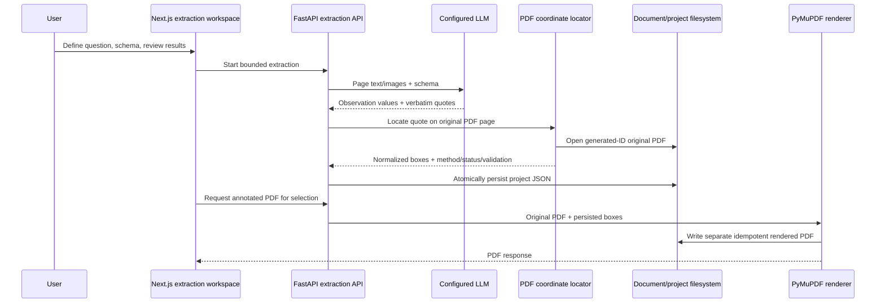

# Evidence-Grounded PDF Extraction and Rendering

## Purpose and architecture assessment

DocuSight is a local-first FastAPI + Next.js application. It stores uploaded originals and page PNG renders under generated document IDs in `data/docs/`. Extraction projects, schemas, observations, evidence, and review state use atomically replaced JSON files under `data/extraction_projects/`; there is no relational database or account/auth layer in the current repository. PyMuPDF is already used for PDF parsing and page rendering. The OCR adapter is DeepSeek-OCR-2 and currently exposes recognized markdown/tables, not word-level bounding boxes. LLM provider support is centralized behind the existing client and currently includes the configured Gemini-compatible provider.

This implementation reuses those conventions. It does not add a database, OCR package, agent framework, or duplicate PDF upload/rendering infrastructure.

## Research principles and engineering additions

ScheMatiQ describes question-guided observation-unit discovery, iterative schema discovery, structured extraction grounded in source text, and an editable human feedback loop. DocuSight already follows these concepts through project objective, observation unit, schema discovery/versioning, batch extraction, evidence quotes, and cell correction. This work adds coordinate localization, coordinate review, and original-PDF annotation; those are engineering additions and are not claims about the paper's own implementation. The paper describes a two-stage extraction that first identifies observation units and then fills fields, with targeted follow-up for unfilled fields. DocuSight's existing batch extraction returns observations and fields together; this change preserves that behavior rather than silently claiming it implements the paper's exact staged orchestration.

Reference: [ScheMatiQ paper, arXiv:2604.09237](https://arxiv.org/abs/2604.09237).

## Components and data flow



### Localization algorithm

1. Read only the original PDF resolved through `store.source_path(document_id)`; never accept a filesystem path from the request.
2. Validate 1-based page number against the open PDF.
3. First use PyMuPDF `page.search_for` on the verbatim quote. If it fails, normalize Unicode with NFKC, case-fold, tokenize conservatively, and match a contiguous sequence in PyMuPDF word records. The fallback creates separate rectangles for matched lines.
4. Keep every found rectangle. Repeated matches are labeled `MULTIPLE_MATCHES`; the UI exposes all marked regions rather than choosing an arbitrary first result. Context-aware disambiguation by table headers/labels is a future improvement.
5. Apply PyMuPDF's page rotation matrix before normalization. The canonical UI coordinate system is top-left-origin normalized coordinates relative to the visible rotated `page.rect`, each value bounded to `[0,1]`. Store point-space bounds, visible page dimensions, rotation, CropBox and MediaBox alongside normalized coordinates.
6. Verify positive dimensions and page bounds. Missing native text match becomes `LOCATION_NOT_FOUND`; no guessed box is saved.

No model-supplied coordinate schema is currently requested or accepted. Should one be added, validate page existence, declared units/origin, bounds, and actual quote in-region before using it; otherwise fall back to native localization. OCR text may be used for extraction today, but OCR geometry is not returned by the current adapter. Until it returns word boxes and deterministic conversion metadata, scanned-page text is explicitly not assigned fabricated coordinates.

### Status and evidence contract

Evidence records retain `text`, `page`, `start_char`, `end_char`, `verified`, `document_id`, `filename`, `extraction_method`, `confidence`, `coordinates`, `coordinate_status`, `coordinate_source`, `localization_method`, and `localization_validation`. Confidence is null because the current model response contract has no calibrated confidence. Localization status is separate from extraction cell status. Current values include `NATIVE_TEXT_MATCHED`, `NATIVE_WORD_MATCHED`, `MULTIPLE_MATCHES`, `HUMAN_VERIFIED`, and `LOCATION_NOT_FOUND`.

Each normalized rectangle has `x`, `y`, `width`, `height`, plus original point coordinates, dimensions, rotation, CropBox, MediaBox, origin, and coordinate-system name. The page number is 1-based; image coordinates use top-left origin. Review corrections retain previous boxes in evidence review history and set `HUMAN_VERIFIED`.

## Persistence model

The logical record model maps to existing project JSON (not SQL):

| Logical entity | Existing representation |
|---|---|
| Document | generated `document_id`, original filesystem file, `DocMeta` |
| Extraction schema | project `schema`, `schema_version`, `schema_versions` |
| Extracted record | project `observations[]` |
| Extracted field | observation `fields[field_id]` |
| Evidence location | field `evidence[]` with coordinate and localization metadata |
| Correction audit | `original_model_value`, cell `review_history`, evidence `review_history` |
| Annotated render | deterministic PDF under `data/extraction_projects/rendered/{document_id}/` |

`ExtractionProjectStore.update` applies a mutation under its lock and writes a temporary file followed by atomic replace. A future relational migration should use foreign keys, indexes on project/document/page/field, and a transaction for value + evidence updates. Original PDF bytes remain on the filesystem.

## API contracts

- Existing extraction APIs handle project/schema upload, extraction, results, and cell correction.
- `PATCH /api/extraction/projects/{project_id}/results/{observation_id}/fields/{field_id}/evidence/{evidence_index}/coordinates` accepts `{ "coordinates": [{"x": 0.1, "y": 0.2, "width": 0.3, "height": 0.04}] }`. Boxes are normalized top-left values within `[0,1]`; they are validated against the selected source page, and prior geometry is retained.
- `GET /api/extraction/projects/{project_id}/rendered.pdf?observation_id=...&field_id=...&page=...` renders selected located evidence from the original and returns `application/pdf`. Omit selectors to render all locatable evidence only when it belongs to one source document; multi-document requests must select a document-scoped observation/field or are rejected.
- Existing `GET /api/documents/{document_id}/pages/{page}` returns filesystem-rendered PNG previews for interactive overlays. `GET /api/documents/{document_id}/file` returns the original.

The rendering cache key includes project, evidence selection, and original PDF hash. Generated output is stored separately and written atomically. Internal absolute paths do not appear in API responses. PDF annotations are overlays, do not alter the original file, and repeat deterministically.

## Rendering and correction

The UI reads the cached page PNG and overlays the saved normalized boxes. Selecting a result field selects its evidence page and highlight. Users can edit normalized `x`, `y`, width, and height; the preview reflects the proposed box, then the coordinate correction endpoint validates and saves it as human verified. “Open annotated original PDF” calls the rendering endpoint. The PDF renderer converts visible rotated normalized coordinates back through PyMuPDF's derotation matrix before drawing into the original PDF coordinate space. Labels identify schema fields; verified and unverified states use distinct styles.

## Error handling and limitations

- Unknown project, observation, field, or evidence returns 404.
- Invalid page/box returns 400; missing or unreadable original, or no matching located evidence, returns 409.
- Rendering is restricted to one source PDF per output.
- Repeated values can remain ambiguous; all matches are marked and shown. Table-context disambiguation is not yet implemented.
- OCR word-box recovery is not implemented because the installed adapter drops coordinates. Users can manually supply normalized boxes in the review UI.
- Value confidence is not calibrated or supplied by the LLM contract; it is stored as null rather than fabricated.
- The current extraction flow is not the paper's full two-stage observation discovery plus targeted missing-field retry algorithm.
- This local app has no authentication/authorization layer. Do not expose its filesystem-backed API publicly without adding access controls.
- No benchmark or extraction-accuracy claim is made.

## Example saved evidence

```json
{
  "text": "Revenue: $1,250 USD",
  "page": 1,
  "document_id": "generated-doc-id",
  "extraction_method": "llm_quote_with_native_pdf_validation",
  "confidence": null,
  "coordinates": [{
    "x": 0.11, "y": 0.12, "width": 0.25, "height": 0.02,
    "page_width": 612, "page_height": 792, "page_rotation": 0,
    "coordinate_origin": "top_left",
    "coordinate_system": "normalized_visible_rotated_page"
  }],
  "coordinate_status": "NATIVE_TEXT_MATCHED",
  "coordinate_source": "pdf_text",
  "localization_validation": {"valid": true, "text_matched": true, "bounds_valid": true}
}
```

## Tests and operations

Run from the backend virtual environment with `python -m unittest discover -s tests`. Geometry tests generate small PDFs at runtime, including a rotated page and repeated text; rendering tests assert the original hash remains unchanged and the output contains annotations. Production benchmark PDFs and OCR word-box regression fixtures remain future work. Generated render files are safe to recreate and can be removed from the render cache without deleting source documents or project results.

## End-to-end walkthrough

The user asks for annual revenue and approves extraction. The existing schema flow proposes/saves a Revenue field. The extraction service receives the model's value plus verbatim quote and page; it independently searches the stored original PDF using PyMuPDF. A validated normalized box and localization status are attached to the evidence and persisted in the project JSON. The user selects the result; the workspace loads the original page's cached PNG and overlays the box. The user can adjust normalized bounds, which are validated and recorded with the previous box. When requested, the render API reopens the original PDF, converts the saved visible-page box into PDF coordinates, draws a labeled highlight, and atomically returns a separate annotated PDF.
